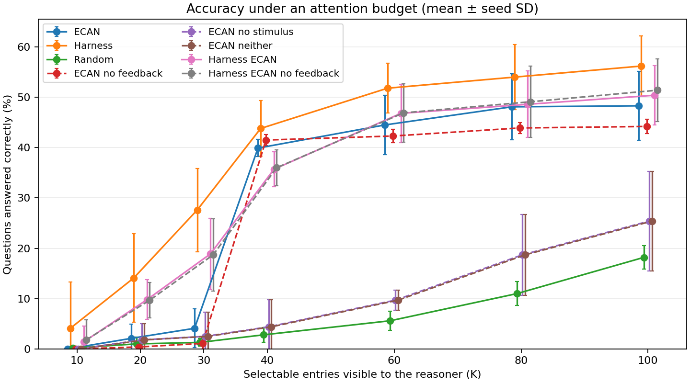
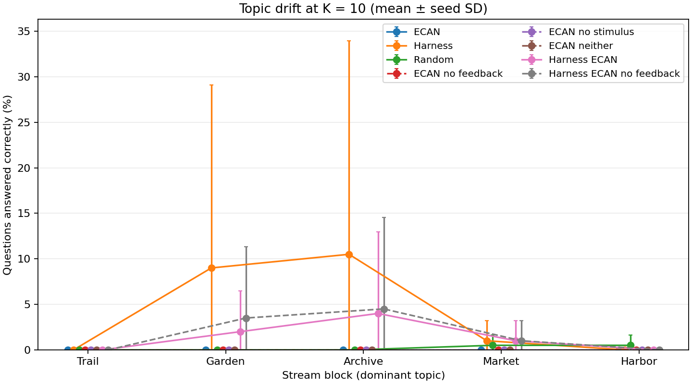

# Attention budget experiment results

## Line D addendum run

The [addendum](PLAN.md#addendum-1120) was committed before scoring. Both hybrids give 0.25 STI to each of the harness's top K nominees and then select by STI. Both track actual focus exposure for recency. Proofs affect only the primary arm's economy, not the retrieval history directly. Only this setting was run.

All eight arms were rerun on the same five seeds, seven budgets, KB and questions. Hyperon checked 56,000 proofs against planted proof membership. All 42,000 original-arm rows matched byte for byte after excluding measured runtime. The generated KB also matched byte for byte. See the [sweep log](outputs/sweep.txt), [raw CSVs](results) and [summary CSV](results/summary.csv) for results, sample SDs and runtime.

### Accuracy

Percent correct, averaged over five seeds. The three ECAN ablations refer to the original keyword stimulus and proof feedback.

| K | ECAN | Harness | Random | ECAN no feedback | ECAN no stimulus | ECAN neither | Harness ECAN | Harness ECAN no feedback |
| ---: | ---: | ---: | ---: | ---: | ---: | ---: | ---: | ---: |
| 10 | 0.0% | 4.1% | 0.2% | 0.0% | 0.0% | 0.0% | 1.4% | 1.8% |
| 20 | 2.1% | 14.1% | 1.0% | 0.4% | 1.8% | 1.8% | 9.8% | 9.7% |
| 30 | 4.1% | 27.6% | 1.3% | 1.1% | 2.5% | 2.5% | 18.9% | 18.7% |
| 40 | 39.9% | 43.8% | 2.8% | 41.5% | 4.4% | 4.4% | 35.7% | 36.0% |
| 60 | 44.5% | 51.8% | 5.6% | 42.3% | 9.7% | 9.7% | 46.8% | 46.9% |
| 80 | 48.1% | 54.0% | 11.0% | 43.9% | 18.7% | 18.7% | 48.6% | 49.1% |
| 100 | 48.3% | 56.2% | 18.2% | 44.2% | 25.4% | 25.4% | 50.4% | 51.4% |

- **Versus harness:** `harness_ecan` lost at every K.
- **Versus `harness_ecan_nofeedback`:** Feedback raised mean accuracy at K = 20 and 30 by 0.1 and 0.2 percentage points. It lowered mean accuracy at K = 10, 40, 60, 80 and 100.
- **Cold start:** Stimulus fixes the initial zero-STI tie without requiring a proof. For all 35 seed and budget pairs, both hybrids selected the harness's first-question focus rather than the no-stimulus ECAN focus. This did not solve proof acquisition or drift at K = 10. Both hybrids scored zero in the first and last blocks.

### Validation

[Python](outputs/python-tests.txt) passed eight tests. [Hyperon 0.2.10](outputs/hyperon-tests.txt) and [PyMeTTa 0.9.4](outputs/second-interpreter-run.txt) each passed 16 shared MeTTa assertions and 384 generated replay assertions. See the [Hyperon replay log](outputs/hyperon-replay.txt). The [full PyMeTTa replay](outputs/pymetta-full-replay.txt) matched both proof depths exactly for all 34,372 distinct recorded focus and query combinations.

## Original pre-registered run

**The claim was not supported.** Stimulus-on ECAN lost to random at K = 10. At K = 20 it beat random but lost to the lexical-plus-recency harness. The harness had the highest mean accuracy at every tested K.

### Setup

The [protocol](PLAN.md) was committed before scoring. No tuning or held-out selection was performed. The [seeded generator](src/design.py) produced a [MeTTa KB](results/kb.metta) with 180 observations and 20 unary rules across five topics. Of the observations, 120 were same-subject metadata distractors. Each of 60 distinct subjects had one valid proof. Thirty proofs required one observation and one rule. Thirty required one observation and two rules. Thus 197 or 198 of the 200 entries were not needed for any given answer. Metadata and productive observations for the same subject tie on raw keyword overlap.

Each seed supplied 200 questions in five blocks of 40, with the first eight questions of each new block alternating old and new topics. The measured sweep used seeds 11, 23, 37, 47 and 59, seven budgets and six conditions, yielding 210 runs and 42,000 scored questions. Both executions of the fixed sweep used the same parameters. The original [log](https://github.com/paxtonhare/agi502-attention-budget/blob/01349d3/outputs/sweep.txt) and [CSV files](https://github.com/paxtonhare/agi502-attention-budget/tree/01349d3/results) are from the integrated reproduction run.

Each question admitted exactly K entries. Hyperon loaded only those observation and rule atoms into the query space. The [MeTTa chainer](src/chainer.metta) finds forward proof paths with at most two rule applications using bounded joins. It does not materialize intermediate facts. Python handled selection, ranking, STI, co-use links, logging and plotting. The [MeTTa scalar specifications](src/economy.metta) exercise the updates and ranking math independently and are not the runtime economy. This split was chosen for straightforward batched state management, not on the basis of a measured MeTTa slowdown. Every Hyperon proof was checked against membership of the planted proof after selection.

### Numbers

Percent correct, averaged over five seeds. ECAN and no feedback use keyword stimulus. Neither turns off both stimulus and feedback. The [original summary CSV](https://github.com/paxtonhare/agi502-attention-budget/blob/01349d3/results/summary.csv) has per-block and overall sample SDs and mean wall runtime. Mean end-to-end picker and reasoner time per 200-question run ranged from 0.291 to 0.390 seconds in the captured run. This includes focus-space updates and feedback but excludes CSV I/O, proof validation, setup and plotting.

| K (% of KB) | ECAN | Harness | Random | No feedback | No stimulus | Neither |
| ---: | ---: | ---: | ---: | ---: | ---: | ---: |
| 10 (5%) | 0.0% | 4.1% | 0.2% | 0.0% | 0.0% | 0.0% |
| 20 (10%) | 2.1% | 14.1% | 1.0% | 0.4% | 1.8% | 1.8% |
| 30 (15%) | 4.1% | 27.6% | 1.3% | 1.1% | 2.5% | 2.5% |
| 40 (20%) | 39.9% | 43.8% | 2.8% | 41.5% | 4.4% | 4.4% |
| 60 (30%) | 44.5% | 51.8% | 5.6% | 42.3% | 9.7% | 9.7% |
| 80 (40%) | 48.1% | 54.0% | 11.0% | 43.9% | 18.7% | 18.7% |
| 100 (50%) | 48.3% | 56.2% | 18.2% | 44.2% | 25.4% | 25.4% |

- **Falsifier 1 (no better than random):** triggered at K = 10 for ECAN with and without stimulus. Not triggered at K = 20 for either.
- **Falsifier 2 (beats random but not harness):** not applicable at K = 10. Triggered at K = 20 for ECAN with and without stimulus.
- **Feedback:** At K = 10 the stimulus-on arms tied at zero. At K = 20 feedback improved accuracy over its matched control from 0.4% to 2.1%. All those ECAN successes were in the first block. At K = 40 the matched control did better. Without stimulus, feedback never changed the selected sets. Rent, wages and diffusion did not move a proof entry far enough for an unselected zero-STI entry to replace it in these runs.

[Original accuracy chart](https://github.com/paxtonhare/agi502-attention-budget/blob/01349d3/results/accuracy.png) and [original K = 10 drift chart](https://github.com/paxtonhare/agi502-attention-budget/blob/01349d3/results/drift.png).

### Interpreters

[Hyperon 0.2.10](https://pypi.org/project/hyperon/0.2.10/) and [MesTTo PyMeTTa 0.9.4](https://pypi.org/project/PyMeTTa/0.9.4/) ran the same MeTTa sources. PyMeTTa is Python-facing but uses a PeTTa-derived Prolog engine, independent of Hyperon's Rust engine. It is a literal public match for the course name. The course's intended version or distribution was not independently confirmed. The [investigation log](outputs/second-interpreter-investigation.txt) records package searches, installation and errors.

Both passed 16 shared `assertEqual` tests and 288 generated replay assertions. Success printed unit `()` in Hyperon and Boolean true in PyMeTTa. The [original full PyMeTTa replay](https://github.com/paxtonhare/agi502-attention-budget/blob/01349d3/outputs/pymetta-full-replay.txt) compared both proof depths on 23,959 distinct focus and query combinations from all 42,000 sweep rows. No proof differences were observed. This replay used recorded focus sets, not independently rerun pickers. [Upstream PeTTa](https://github.com/trueagi-io/PeTTa/commit/ee5cacb6a6ecdd554a1c773aaf47e9a0f8a5af0f) additionally passed fixtures and generated replay with a temporary `test` adapter, not native `assertEqual`.

### Upstream comparison

[iCog metta-attention](https://github.com/iCog-Labs-Dev/metta-attention/commit/d3a3c0e369df052e31992fcdbafdec4a42d1a3ad) likewise uses STI to govern attentional focus, stimulus to grant wages, rent to reduce balances and links to spread importance. Its bank prices wages against its funds and tracks longer-term values as well. Its AF and wider-space agents include time-gated rent and diffusion via incident and Hebbian links. Its link creation and strength updates are separate agents. Here there is one STI balance per entry, fixed per-question proportional rent, fixed proof wages, proof-only co-use counters and simultaneous normalized spread. There is no bank, LTI, VLTI or forgetting. The [native iCog suite](outputs/upstream-native.txt) passed 23 test files and skipped one excluded forgetting test once PeTTa was available. The [upstream log](outputs/upstream.txt) records the initial missing-runner failure, a fluid-diffusion smoke pass, 20 Synapse tests and 26 CAIRN Python tests.

[CAIRN's unpriced steering](https://github.com/trueagi-io/CAIRN/blob/36fd7f1b9435c2030acb16ed6de0744379ca2b72/bridge/steering.metta#L1-L63) compares all premises, real focus and seeded random focus under the same PLN step limit. Both designs match random focus size. CAIRN then gates premises by the query and focus, so equal focus size need not mean equal premises admitted. Here focus contains premises directly, so exactly K enter the fixed-depth reasoner in every arm. The CAIRN PLN experiment was inspected but not run.

### Limitations

Synthetic topics have distinct labels and recurring subjects, so performance is not a measure of natural-language retrieval or PLN. This harness is one strong lexical heuristic, not a deployed LLM agent. Every question is answerable with the full KB. The score does not measure false answers on negative examples. Success-only feedback can stall without exploration. The two feedback mechanisms were ablated jointly, so wages and Hebbian spread cannot be credited separately. Five seeds share one synthetic KB. Error bars describe variation over seeds, not confidence intervals or a significance test. These results test this implementation and stream, not ECAN in general.

### Assistant failures

- Initially treated upstream PeTTa's zero exit on residual `assertEqual` expressions as a candidate pass signal. Reading the output exposed that no checks ran. The adapter and a deliberately false test verified fail-closed behavior.
- The initial full replay called PyMeTTa `render(atom)` with an unsupported signature. Using `format(atom, "sexp")` enabled exact proof comparison.
